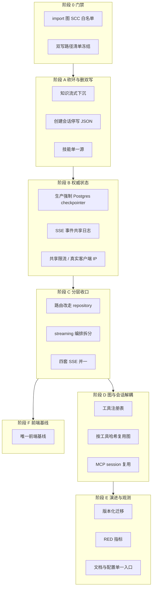

# 架构改进计划：权威状态、分层与单一写路径

| 项 | 内容 |
| --- | --- |
| 状态 | 设计草案（待评审后实施） |
| 日期 | 2026-10-18 |
| 依据 | 当前工作区对照盘点终态；`docs/design/2026-10-17-module-refactor-plan.md`（ARCH-03/04）；`docs/design/2026-10-17-multi-instance-state.md`（Phase B/C/D 未做）；`docs/design/2026-10-17-sse-event-contract.md`；`docs/audit/evidence/T4-architecture.md` |
| 约束 | 不改变对外 HTTP/SSE 契约（可加字段、不可改既有字段语义）；每阶段可独立发布、可回滚；新行为必须有测试；不编辑既有盘点 plan 文件 |

## 0. 问题与原则

过渡契约已经铺上（会话流锁、repository 抽取、可选 Postgres checkpointer、HITL 外置、探活拆分）。**还没立住的是边界**：运行时仍是进程内应用；API 仍直打 `Database` 门面；一次对话有四套 SSE；多条写路径并存。

原则（按优先级，违反则本阶段不算完成）：

1. **先定权威，再拆文件。** 同一领域只保留一条写路径。
2. **先砍环，再迁调用方。** SCC 回边比巨型文件更阻碍并行。
3. **进程内缓存只能是快路径。** 多副本下权威在共享存储。
4. **图与会话解耦。** 编译图按「模型 + 工具集」复用，会话只换 `thread_id` 与 backend 根。

非目标：不重写 Deep Agents 装配循环；不引入必须的 Redis（DB-first，规模化后再加）；本计划不强制一次切 Vue3（见阶段 F 决策项）。



与已有设计的关系：A/C 承接 module-refactor Phase 1–3 剩余项；B 承接 multi-instance Phase B–D；SSE 契约文档是 C 的事件表，本计划规定落地顺序。**已完成项不再列入任务。**

---

## 阶段 0 · 门禁（0.5–1 天，低风险）

把「不能再恶化」写成 CI，不改业务行为。

| 任务 | 做什么 | 验收 |
| --- | --- | --- |
| 0.1 import 图 | 把 `_analysis/t4_import_graph*.py` 收成 `scripts/import_graph.py`；CI `--check-scc`，白名单仅现有环并注释原因 | 新回边失败；白名单只减不增 |
| 0.2 双写冻结 | CI 禁止在 `Database` 新增业务方法；禁止新增 `sessions.messages` 写入点 | PR diff 门禁 |
| 0.3 最小 lint | `[tool.ruff]` F/E9；`pytest --collect-only` 无 error | 与现有 `tests/` 绿并存 |

**回滚：** 删除 workflow job 即可。

---

## 阶段 A · 砍环与删双写（3–5 天，风险中）

结构最小两刀 + 技能源收口。不碰 HITL 策略、不拆 streaming 深度。

### A1 知识流式下沉（断 `knowledges.api → api.chat`）

- 知识面板流式逻辑落到 `knowledges/chat/`（已有 `streaming.py` / `chat_bridge.py`）。
- `knowledges/api.py` 删除对 `api.chat.chat_stream` 的反向 import；主 `api` 只挂路由或薄适配。
- 同步处理 `tools.scheduled_task → services.scheduler`：工具只依赖端口（提交/查询接口），不 import 调度器实现。

验收：AST import 图 SCC = 0（白名单空）；知识面板发一条消息行为与现网一致（golden SSE 或现有 knowledge 测试）。

### A2 会话消息单一写路径

- `create_session` 不再 `json.dumps` 写入 `sessions.messages`；新行只写元数据，正文只进 `session_messages`。
- 列表/详情热路径保持只读行表（已是现状）。
- 空行表回退读 JSON **仅保留一个标记为 deprecated 的函数**，加计数日志；下个小版本删除列（见 E1）。

验收：新建会话后 `sessions.messages` 为空或固定 `'[]'`；`get_messages` 只走行表；`tests/db` 覆盖创建 + 追加 + 列表。

### A3 技能单一安装源

- 运行时只认根 `skills/`（或只认包内，二选一，推荐根目录为 canonical，安装期 copy 进包）。
- `scripts/sync_skills.py` 从「对账」改为「单向生成 + CI 哈希」；office 12 文件全量哈希，不只 `base.py`。
- 不在本阶段删除 `.agents/skills`（开发技能，非运行时）。

验收：改一个 office 脚本只需改 canonical 一处；CI 发现第二棵树漂移即失败。

**回滚：** A1 保留适配函数一版；A2 双写开关 `EASY_SESSION_JSON_DUAL_WRITE=1` 默认关。

---

## 阶段 B · 权威状态（1–2 周，风险中高）

对应 multi-instance Phase B/C/D。单机 dev 仍可零 Redis。

### B1 生产 checkpointer / Store 契约

- `AGENT_ENV=prod` 且 replicas/workers > 1 时：**强制** `EASY_CHECKPOINT_POSTGRES_URI`，禁止 MemorySaver pickle 回退。
- `deploy/k8s/agent-deployment.yaml` 注入该 URI（Secret）；文档写明 app DB 仍是 MySQL、HITL checkpoint 在 Postgres。
- Store：短期保持 MySQL `SqlStore`（与 app 事务同库）；长期官方 `PostgresStore` 仅在确认跨库事务可接受后单独立项，**不与 B1 捆绑**。
- 记忆文件 `/memories/AGENTS.md`：多副本依赖现有 RWX；不在本阶段改 StoreBackend。

验收：未设 URI 的 prod 多副本启动失败；设 URI 后 HITL resume 跨进程可测（现有 checkpoint roundtrip + 双进程用例）。

### B2 SSE 事件外置（进程内 hub 降为快路径）

- 表 `stream_events(stream_id, seq, payload, created_at)`，短 TTL。
- 生产者：主聊天生成器每条对外事件先写共享日志，再推本进程 hub。
- `/stream/live`（或现有重连入口）：先按 `stream_id+last_seq` 回放，再订阅本进程或轮询增量。
- `/cancel` 已写 DB 标记；owner 心跳续约保持现状。非 owner 副本必须能回放至 `done/error`。

验收：两副本 + 负载均衡下，刷新/重连拿到最近事件；杀掉 owner 后客户端收到明确结束而非挂死。

### B3 限流与 JWT 生产契约

- 限流按真实客户端 IP（已有 `EASY_TRUST_PROXY` / `client_ip`），禁止裸 `request.client.host` 作为唯一键。
- `BaseHTTPMiddleware` 内禁止 `raise HTTPException`（会变 500）；改为 JSONResponse 429。
- 多副本：DB/表计数或后续 Redis；replicas>1 时进程内计数仅告警不够，**B3 必须共享计数或 fail-fast 提示配共享存储**。
- prod 禁止 JWT 落到 `data/.jwt_secret`：未设 `EASY_JWT_SECRET` 启动失败。

验收：限流返回 429；k8s 样例含 JWT Secret；单测覆盖中间件状态码。

### B4 后台任务单领袖

- 调度器：`distributed_lock.enabled=true` 作为多副本前置，启动校验 fail-fast（现状偏告警）。
- 知识库 worker：DB 租约 leader，非 leader 只做健康检查。

验收：两副本下同一 cron 只跑一次；worker Ragflow 调用不随副本数线性放大。

**明确不做（本阶段）：** 远程 sandbox、WebTerminal pty 跨 Pod 粘滞、默认 LangSmith。终端保持「连到哪台是哪台」或文档标注会话亲和。

---

## 阶段 C · 分层收口（1–2 周，风险中）

在环已断、消息单写之后再拆大文件，否则只是把环复制到新模块。

### C1 路由停止使用 `Database` 门面

- `api/*` 改为 `Depends` repository（sessions / users / files / runtime）。
- `Database` 委托方法标 deprecated，禁止新调用；目标 `database.py` ≤ 300 行，只留连接/事务/迁移入口。
- SQLite/MySQL 方言收到 `db/dialect.py`，repository 不写双分支。

验收：`api/` 无 `from ..db import Database` 业务调用（`get_database` 仅测试/生命周期可留）；门面方法调用点 = 0 或仅 `__getattr__` 兼容层。

### C2 streaming 拆为编排器

目标目录：

```
easy_agent/services/streaming/
  orchestrator.py   # 会话注册 / 取消 / 事件序列
  projector.py      # astream → 内部事件（可暂留 messages/updates）
  persistence.py    # 增量落库、最终消息、checkpoint
  side_effects.py   # workspace rename、技能入库、记忆
  sse.py            # 唯一 format_sse + 注册表（已有 services/sse.py 则迁入）
```

- 先纯移动 + 重导出，golden SSE 对比后再删旧文件。
- `resume_stream_generator` 与 `chat_stream_generator` 共用 orchestrator。

验收：`streaming.py` 不再存在或 < 200 行兼容垫片；单文件 ≤ 800 行；现有 stream 测试全绿。

### C3 四套 SSE 并一

- 知识库、专家导出/拒答改走同一 `format_sse` + 事件注册表（见 `2026-10-17-sse-event-contract.md`）。
- `_StreamHub` 只做广播，不产私有事件名。
- 前端（当前托管的 `frontend-vue2`）聊天/专家/知识消费收敛到一个 parser；Vue3 目录本阶段只跟契约或冻结（见 F）。

验收：事件名集合与注册表一致；CLAUDE.md / requirements 由脚本或表生成，禁止手写第二份清单。

**回滚：** 兼容垫片保留一个小版本。

---

## 阶段 D · 图与会话解耦（1–2 周，风险中高）

依赖 C2（装配入口清晰）和 B1（checkpointer 可跨进程）。

### D1 工具注册表

- 每个工具声明：schema、HITL 标记、前端呈现元数据、是否 MCP。
- `agent_manager` 只遍历注册表，删除硬编码 `if/append`。
- `write_file` 是否进 HITL **单独产品决策**，本阶段只做到「改一处名单生效」。

验收：新增内置工具不改 `agent_manager` 主流程；HITL 名单来自注册表。

### D2 编译图复用

- 缓存键：`(model_id, tools_hash, system_prompt_hash, middleware_hash)`。
- 会话差异（workspace 根、thread_id、专家目录、连接器开关）进 `config` / backend，不进编译。
- 专家或连接器变更 → 哈希变 → 惰性淘汰（DB 可记 cache_generation，替代跨副本广播）。

验收：两会话同模型同工具集只编译一次（单测 spy `create_deep_agent`）；换 thread 对话状态不串。

### D3 MCP 连接策略

- 按 server 复用 session，而不是每次工具调用新建。
- stdio 与 HTTP 生命周期分开；文档标注多副本下 stdio MCP 不共享。
- `tool_name_prefix` 避免多 server 撞名。

验收：同一轮对话对同一 server 的连续工具调用不重复握手（mock client 计数）。

**明确不做：** 升级 deepagents 到 0.7+ 换公开 summarization API（可并行小项，不阻塞 D）；execute 描述去 `FilesystemMiddleware.__init__` 包装列为 D 的收尾小项。

---

## 阶段 E · 演进、配置与观测（持续，每项可单独 PR）

### E1 Schema 版本化

- 引入 Alembic（或等价），禁止启动期 `ALTER TABLE` 作为唯一迁移手段；启动只校验 `schema_version`。
- 删除 `sessions.messages` 列：回填确认零依赖后独立迁移。
- 多实例滚动：迁移 Job 先于新 Pod。

### E2 配置单一入口

- Pydantic Settings 收拢 `EASY_*`；禁止新的裸 `os.getenv`（CI grep）。
- `config.yaml` 与 `config-example.yaml` 键集合 CI diff。
- 拆 `mcp.json` 的连接器目录 vs servers 双语义。

### E3 观测

- 主聊天 RED：请求 QPS、SSE 时长、token、工具失败率、HITL 等待。
- 结构化日志已有 session 维度则挂钩 `stream_id`。
- 默认 LangSmith 仍为可选，不强制。

### E4 文档与死代码

- CLAUDE.md / AGENTS.md 模块清单改为生成或与代码同期改。
- 删除空目录、错误 console script、未挂载 swagger 静态资源。

验收：新环境只靠 example env + example yaml 能启动；未知配置键 fail-fast。

---

## 阶段 F · 前端唯一基线（独立决策，L）

后端契约收口之前可以并行**冻结**其中一套，但合并必须有明确决策：

| 选项 | 含义 |
| --- | --- |
| F-vue2 | 继续以 `frontend-vue2` 为唯一托管源；`frontend/` 归档不再改 |
| F-vue3 | 迁移完成后只构建 `frontend/`；vue2 归档 |

无论哪项：引入 vue-router（或 Vue3 router）、按域拆 `App.vue` 状态、SSE parser 唯一。本计划不把「重写 ChatInput」当作架构前置。

验收：Dockerfile / `easy-web` / README 只指向一套；CI 只 build 一套。

---

## 依赖与并行

```
0 ──► A1 ──► C1
      A2 ──► E1（删 JSON 列）
      A3
      A1 ──► C2 ──► C3 ──► F（parser）
              C2 ──► D1 ──► D2
      B1 ──► D2
      B2 可与 C2 并行，但 C3 应消费 B2 的 stream_id/seq
      B3 / B4 可与 A 并行
```

建议第一批落地（约一周）：**0 + A1 + A2 + B3**。收益高、不依赖 Postgres 运维，且直接减少环和 500 误报。

---

## 风险

| 风险 | 缓解 |
| --- | --- |
| 知识流式下沉后参数/鉴权不一致 | 先适配再删旧 import；knowledge 现有 API 测试作契约 |
| 停写 JSON 后旧会话读空 | 保留只读回退至 E1；回填脚本统计空行表会话 |
| 强制 Postgres 阻塞现有 MySQL 单机 prod | 仅 `replicas/workers>1` 强制；单副本仍可 pickle（文档标明不可水平扩） |
| 事件外表放大写入 | TTL + 仅对外 SSE 事件落库，内部思考增量可抽样 |
| 图复用串会话文件 | 测试两个 workspace 根并行 invoke；backend 必须按请求注入 |
| Alembic 与启动自愈双跑 | 迁移期自愈只补列不改类型；开关 `EASY_SCHEMA_AUTO_REPAIR` 默认关 |

---

## 总验收（全部阶段完成后）

- import 图 SCC = 0，白名单为空。
- 生产多副本：Postgres checkpointer + 共享 workspace + 共享限流 + 调度/知识库单领袖；SSE 重连不丢权威事件。
- `Database` ≤ 300 行；`api` 不直打门面；主聊天 streaming 包内单文件 ≤ 800 行。
- 新建会话无 JSON 双写；运行时技能只有一棵树；SSE 事件只有一张注册表。
- 同模型同工具集跨会话不重复 `create_deep_agent`。
- 前端与 Docker 只构建一套 UI。

未完成前，盘点 todo 的「completed」仍只表示过渡契约，不表示终态。


## 实施进展（2026-10-18）

| 阶段 | 状态 | 说明 |
| --- | --- | --- |
| 0 门禁 | ✅ | `scripts/import_graph.py` + CI SCC 白名单；`scripts/check_double_write.py`；`architecture-gate` job |
| A2 会话消息单写 | ✅ | `create_session` 不再写 JSON（空串占位）；legacy 只读回退保留；双写门禁通过 |
| B3 第一批 | ⏳ | 429 JSON、真实 IP、prod JWT fail-fast、多副本告警已做；共享计数未做 |
| C1 第一批 | ⏳ | sessions 域 `SessionRepository` + API 去门面；其他 API 域未迁移 |
| A1/A3/B1/B2/C2/C3/D/E/F | ❌ 未做 | 其中多副本 B/C、streaming 深度拆分、HITL 策略按用户指示暂缓 |

详见 `docs/audit/2026-10-18-next-batch-report.md`。


## 实施进展（2026-10-18 第二批）

| 阶段 | 状态 | 说明 |
| --- | --- | --- |
| C1 剩余与 sessions 域 | ✅ | `User/File/ScheduledTask/Expert/Chat/Session Repository`；目标 API 无 Database 门面 |
| C2 streaming 拆分 | ✅ | projector/persistence/side_effects/orchestrator；`streaming.py` 12 行兼容垫片；SSE 契约不变 |
| B1 checkpointer/Store | ✅ | prod 多副本 fail-fast + 逃生门；K8s PG URI/副本数；官方 AsyncPostgresStore 可选，MySQL `SqlStore` 回退 |
| D1 工具注册表 | ✅ | 14 条 ToolSpec；agent_manager/hitl 接入；SCC 不变 |
| D3 MCP session 复用 | ✅ | 官方 `client.session` + `load_mcp_tools(session=...)`；app shutdown 关闭 |
| D2 编译图复用 | ✅（进程内） | `agent_graph_cache.py` + `SessionContext` + official callable backend/context；opencode/legacy 降级 |
| A1/A3/B2/C3/E/F | ❌ 未做 | 仍按计划待实施；多副本 Phase B/C 的大部分未做 |
| Batch 0/1 安全 | ❌ 未执行 | 用户未选 |

详见 `docs/audit/2026-10-18-c1-c2-b1-d-report.md`。


## 实施进展（2026-10-18 第三批：非安全剩余项）

| 项 | 状态 | 说明 |
| --- | --- | --- |
| FW-04 execute 描述 | ✅ | 官方 `HarnessProfile.tool_description_overrides` 替代 monkeypatch |
| A1 知识流式下沉 | ✅ | 端口化；import SCC=0，白名单空 |
| A3 技能单一源 | ✅ | `sync_skills.py` 单向生成/全量哈希/CI check |
| C2 finalize_stream | ✅ | chat/resume 收尾公共化 |
| C3 SSE 并一 | ✅ | 24/24 frame 站点经 `SSEEmitter`；golden 字节等价 |
| C1b 服务边界 | ✅ | 目标 API `repo.database` 19→7；剩余边界登记 |
| E2/E3/E4 | ✅ | 配置校验/CI 门禁、RED 指标、文档事实同步 |
| FW-12/FW-14 | ✅ | 动态 HITL 名单；mcp-server ToolError/isError/structuredContent |
| 专项增强 | ✅ | 记忆跨进程锁/原子双写；外部数据来源引用规则 |
| FW-11 `query` 语义 | ⚠ | SQL store 无 embedding/向量索引，记录为后续（PostgresStore 路径可用） |
| B2/多副本 Phase B/C、Batch 0/1 | ❌ | 未做/未执行 |
